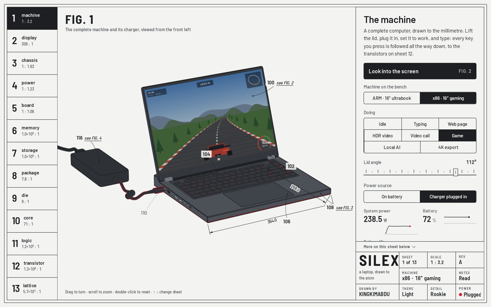

<div align="center">

# SILEX

**A laptop, drawn down to the atom.**

An explorable engineering drawing in thirteen sheets, from the machine on a desk to the silicon crystal inside its transistors. Every sheet is a working model you operate, not an illustration.

**[Open SILEX](https://kingkimabdu.github.io/SILEX/)**



</div>

## What it is

Most explainers of how a computer works stop at a block diagram. SILEX keeps going. It starts with a complete laptop at 1 : 2.5 and zooms, sheet by sheet, into the chassis, the logic board, the processor package, the die, one core, a 4-bit adder, a single transistor and finally the silicon lattice at more than 6 × 10⁷ : 1. The title block always shows the true scale against the real object.

Each level runs a simulation you can drive, and the levels are connected. Press a key on your own keyboard and the same key goes down on the drawing, the keypress is timed on its way to the screen, and sheet 12 shows the transistors it ends up switching. Start a 4K export on the chassis sheet and the die sheet shows which blocks are drawing the power.

## The thirteen sheets

| Sheet | What you operate | What the model computes |
|---|---|---|
| **1 · Machine** | The lid, the charger, the workload, and your own keyboard | Every key labelled and pressed on the drawing; the keypress-to-photon chain; live screen apps with frame rate and AI tokens per second; battery and charger flow |
| **2 · Display** | A colour, the brightness, the layers pulled apart | OLED against mini-LED, pixel by pixel: emitters, liquid-crystal twist, colour filters, panel power, PWM inside one frame |
| **3 · Chassis** | Workload, charger, room temperature, a 4K export | CPU and GPU thermal masses on shared cooling, the fan curve, PL1/PL2 and GPU board power, battery limits; time and energy for the same job on both machines |
| **4 · Battery** | Charger, 80 % battery care, simulation speed | CC-CV charging, cell voltage under load, lithium ions crossing the separator, the USB Power Delivery handshake, 20 V to 1 V buck conversion |
| **5 · Logic board** | A job: a keypress, a file, a 7B language model, a game level, a call, a sound | Every hop timed from real link bandwidth and latency, including PCIe to the GPU and GDDR7; live current on every rail |
| **6 · Memory** | Write and read DRAM cells, refresh, chip temperature | Capacitors 35 nm wide and 1.2 µm tall leaking charge; refresh racing the leak; the sub-100 mV signal of a read |
| **7 · Storage** | Program a 3D NAND cell with three bits | Incremental step programming, electrons in the charge-trap film, eight threshold levels |
| **8 · Package** | The cutting plane, the vertical exaggeration | A true section with material hatching: solder balls, substrate, bumps, the die or the stacked tiles |
| **9 · Die** | Workload, core type and clock | Blocks rise with the watts they draw; P = k·V²·f + leakage explains why chips mix kinds of core |
| **10 · Core** | Width, reorder buffer, in-order or out-of-order, memory level, branch predictor | A real loop in AArch64 and x86-64 machine code, run functionally, then through a cycle-level out-of-order timing model |
| **11 · Logic** | The bits of two numbers | A 4-bit adder of 36 NAND gates, simulated event by event in picoseconds, with one gate shown at transistor level |
| **12 · Transistor** | Gate and drain voltage; the FinFET in these machines or the gate-all-around device that follows it | A compact device model: drain current, subthreshold swing, on/off ratio, electrons in the channel |
| **13 · Lattice** | Phosphorus or boron atoms, doping, temperature, an electric field | Diamond-cubic silicon at a = 5.431 Å; carriers, mobility and resistivity |

## Two machines

The drawing compares two laptops of the same size and opposite design. Switch between them from the title block and every sheet follows.

- **ARM ultrabook, 16-inch.** 355.4 × 250.4 × 12.3 mm, OLED at 120 Hz, a twelve-core Snapdragon X class SoC with memory beside it, one quiet fan, a 65 W USB-C charger.
- **x86 gaming laptop, 16-inch.** 354 × 268 × 22.8–30.8 mm, mini-LED at 240 Hz, a 24-core processor and a discrete GPU, three fans, a lid with an LED matrix, a 380 W adapter.

They are drawn from published dimensions and review photographs of the Samsung Galaxy Book4 Edge 16 and the ASUS ROG Strix SCAR 16 (2025). Port positions, chargers and cooling layouts follow those machines. Power, chip and memory figures are typical values for their class.

## How to read the drawing

SILEX is drawn like a patent figure, because that is how engineers have always explained machines.

- Reference numerals with leader lines name every part. Select a numeral, or the part itself, to read what it does.
- Black is the drawing. Red is energy and only energy: current, heat, a charged wire, a switching gate.
- A dashed line is idle, a gapped line is switched off, and phantom lines show parts drawn only to reveal what is behind them.
- Cut surfaces carry the hatching of their material. Dimension lines give real sizes, from 355.4 mm down to 5.431 Å.
- **Rookie** shows the essentials; **Grind** shows every number and control. **Light** and **Graphite** set the paper.
- Every experiment you run is entered in the revision table.

**Controls:** drag to turn the drawing, scroll or pinch to zoom, double-click to reset. ↑ and ↓ move between sheets and digits jump to one; on sheet 1 the keyboard types instead.

## Accuracy

The simulations are simplified physical models, not vendor data, and each sheet says what its model leaves out. Thermal behaviour is a two-node network calibrated to published measurements, the core is a timing model rather than an RTL simulation, and the transistor is a compact model rather than a device simulation. Process names such as "3 nm" are generation names, not a length on the device; sheet 12 dimensions the real features.

Corrections are welcome. If a number is wrong, please open an issue with a source.

## Run it locally

Requires Node.js 22 or later.

```bash
git clone https://github.com/KINGKIMABDU/SILEX.git
cd SILEX
npm install
npm run dev
```

`npm run build` type-checks the project and writes a static site to `dist/`. Pushing to `main` deploys it to GitHub Pages through the included workflow.

## Project layout

```
src/
  main.ts          sheet rail, spec column, title block, routing
  core/            stage and camera, line-art renderer, overlay of numerals and dimensions, themes, UI controls, machine specs
  sim/             thermal and power model, out-of-order core model
  sheets/          one file per sheet; machine/ holds the laptop model, keyboard, ports, chargers and screen apps
public/            favicon, social image, third-party notices
```

Built with TypeScript, three.js and Vite. No UI framework, no backend, no tracking. Fonts (Barlow, Barlow Semi Condensed, JetBrains Mono) are self-hosted.

## Licence

SILEX is released under the [MIT Licence](LICENSE). Third-party licences for three.js and the fonts are in [`public/THIRD_PARTY_NOTICES.txt`](public/THIRD_PARTY_NOTICES.txt).

SILEX is not affiliated with or endorsed by Samsung, ASUS, Qualcomm, Intel, NVIDIA or Microsoft. Product names are trademarks of their owners and are used only to identify the reference hardware. The drawings reproduce no logos or markings.

---

<div align="center">

Concept, drawing, simulations and code by [Abdullah Alhariri (KINGKIMABDU)](https://kingkimabdu.github.io/).

More of my work: [kingkimabdu.github.io](https://kingkimabdu.github.io/) · [github.com/KINGKIMABDU](https://github.com/KINGKIMABDU)

</div>
